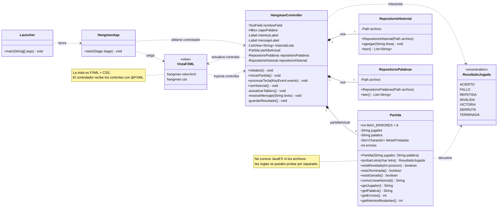

# Diagrama de clases inicial — Hangman

**Fecha:** 25/11/2026  
**Momento:** diseño previo a la implementación de los repositorios de archivos y de la interfaz completa.  
**Uso:** este diagrama es la línea base del proyecto. El diagrama final se ajustará a lo que realmente quede implementado; las diferencias servirán para explicar la evolución del diseño en el informe.

> El diagrama está en formato Mermaid. GitHub y el panel de revisión lo renderizan directamente; también se puede exportar como imagen para el PDF.

## Diagrama

## Correspondencia con MVC

| Capa | Clases / archivos | Responsabilidad |
|---|---|---|
| Modelo | `Partida`, `ResultadoJugada`, `RepositorioPalabras`, `RepositorioHistorial` | Reglas del juego y acceso a `palabras.txt` / `historial.txt`. No dependen de JavaFX. |
| Vista | `hangman-view.fxml`, `hangman.css` | Controles, casillas y estilos. |
| Controlador | `HangmanController` | Recibe los eventos, actualiza la partida, pide datos a los repositorios y refresca la vista. |
| Arranque | `Launcher`, `HangmanApp` | Inicia JavaFX y carga el FXML. |

## Decisiones de esta versión

1. **`Partida` concentra las reglas.** El controlador no calcula aciertos, errores ni victoria; solo interpreta el `ResultadoJugada`.
2. **Los repositorios aíslan los archivos.** El controlador no usa `Files` directamente, y los repositorios se pueden probar con archivos temporales.
3. **La vista es FXML.** No se crea una clase Java adicional para la vista; el controlador actualiza los controles inyectados.
4. **Una sola línea de historial por partida.** `Partida` solo permite generar la línea cuando está terminada, y el controlador deja de procesar teclas en ese estado.
5. **El diagrama es inicial.** Si durante la implementación cambia el manejo del teclado, los estados o la forma de guardar, se documentará el cambio y se actualizará el diagrama final.
